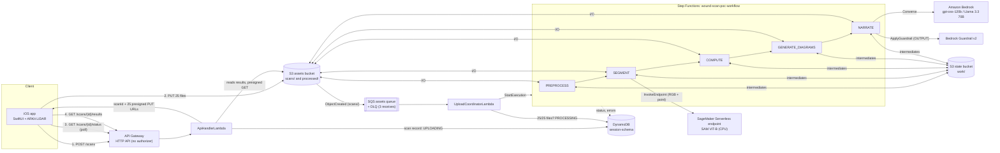

# Albacete MedDev Wound Scan PoC - Technical Documentation

> **Last updated:** 2026-11-16 · **Environment:** `poc` · **AWS account:** `962524581373` · **Region:** `us-east-1`
>
> This document describes the solution **as implemented in this repository** (`PoC-woundscan/`): an iOS LiDAR capture app, a serverless AWS backend (CDK, Python 3.13) and a measurement pipeline that turns a 5-frame LiDAR burst into wound measurements, two diagrams and a plain-language summary.
> Resource names, limits and thresholds below are taken from the source code and CDK configuration (`IaC/lib/config/poc.ts`). 

## Table of Contents

1. [Solution Architecture](#solution-architecture)
2. [Component Descriptions](#component-descriptions)
3. [Measurement Pipeline](#measurement-pipeline)
4. [Narration and Guardrail Pipeline](#narration-and-guardrail-pipeline)
5. [Data Flows](#data-flows)
6. [API Reference](#api-reference)
7. [Data Model](#data-model)
8. [Configuration](#configuration)
9. [Architectural Decisions](#architectural-decisions)
10. [CDK & Source Code Structure](#cdk--source-code-structure)
11. [DevOps: AWS Access, Deployment & Maintenance](#devops-aws-access-deployment--maintenance)
12. [Post-Deployment: Validation with Synthetic Scans](#post-deployment-validation-with-synthetic-scans)
13. [Known Limitations](#known-limitations)

---

## Solution Architecture


*Figure 1 - Solution architecture (`Docs/Albacete MedDev.jpeg`). The figure omits the Bedrock Guardrail, the SQS dead-letter queue and the separate Step Functions state bucket, which are described below and shown in Figure 2.*



*Figure 2 - Component and data-flow view generated from the CDK code.*

**Cross-cutting services**

| Concern | Implementation |
|---------|----------------|
| Encryption at rest | Three customer-managed, multi-region KMS keys: assets bucket, Step Functions state bucket, DynamoDB table |
| Logging | One CloudWatch log group per Lambda (`/aws/lambda/<name>`, 1-month retention) and one for the state machine (`/aws/states/wound-scan-poc-workflow`, log level `ALL`, execution data included) |
| Tagging | Every stack is tagged `Workspace`, `Env` (`poc`) and `CDK=true` |
| Infrastructure as code | AWS CDK v2 (TypeScript), six stacks, deployed with `-c environment=poc` |

---

## Component Descriptions

### Mobile Client (iOS)

| Component | Technology | Purpose |
|-----------|------------|---------|
| App | SwiftUI, iOS 16.0+, portrait only, bundle id `com.nclouds.albacete-meddev` | Single-screen capture flow plus results screen |
| LiDAR capture | ARKit `ARWorldTrackingConfiguration` with `.sceneDepth` and `.smoothedSceneDepth` | Captures RGB, depth map, confidence map and intrinsics. Prefers the 1920-px-wide video format |
| Device requirement | `UIRequiredDeviceCapabilities`: `arkit`, `lidar-depth-sensor` | LiDAR-equipped devices only (the app's own error text says iPhone 12 Pro or later) |
| Networking | `ScanAPIClient` (`URLSession`, 120 s request / 300 s resource timeout) | Calls the three API routes and PUTs files to presigned URLs. ATS exception for `amazonaws.com` only |
| Results | `ResultsView` | Shows length, width, bed area and depth cards, the SVG top view, the PNG cross-section, the narration and a "not a clinical assessment" disclaimer |

Each scan captures **5 frames x 5 files = 25 files** (see [Data Model](#data-model) for formats). RGB frames are JPEG (quality 0.92); depth is the raw ARKit float32 buffer; confidence is the raw uint8 buffer.

### API Layer

| Component | Technology | Purpose |
|-----------|------------|---------|
| API Gateway | HTTP API (API Gateway v2), name `wound-scan-poc-scans-gateway`, default stage | Three routes, all integrated with `ApiHandlerLambda` |
| CORS | `allowOrigins: *`, `allowMethods: ANY`, `allowHeaders: authorization, content-type` | Open CORS |
| Authentication | **None** - no authorizer is configured | See [Known Limitations](#known-limitations) |

Base URL: `https://7vo1pzlg1f.execute-api.us-east-1.amazonaws.com`. The URL is not exported as a CloudFormation output; see [Finding the API URL](#finding-the-api-url).

**Route table** (from `IaC/lib/stacks/compute-stack.ts`)

| Method | Path | Lambda | Purpose |
|--------|------|--------|---------|
| POST | `/scans` | `ApiHandlerLambda` | Create a scan record and return 25 presigned upload URLs |
| GET | `/scans/{scanId}/status` | `ApiHandlerLambda` | Return the scan status |
| GET | `/scans/{scanId}/results` | `ApiHandlerLambda` | Return measurements, diagram URLs and narration (status `COMPLETE` only) |

Full request/response contracts are in the [API Reference](#api-reference).

### Compute (Lambda Functions)

All functions use Python 3.13 on x86_64, `index.handler` as entry point, and a dedicated IAM role and log group each.

| Function (deployed name) | Timeout | Memory | Trigger | Purpose |
|--------------------------|---------|--------|---------|---------|
| ApiHandlerLambda (`apihandlerlambda-poc`) | 30 s | 256 MB | API Gateway | Creates scans, presigned URLs, status and results |
| UploadCoordinatorLambda (`uploadcoordinatorlambda-poc`) | 30 s | 256 MB | SQS (batch size 10) | Counts uploaded frame files; starts the workflow when all 25 are present |
| PreProcessLambda (`preprocesslambda-poc`) | 120 s | 2048 MB | Step Functions | Sharpness scoring, best-frame selection, depth cleanup and registration |
| SegmentLambda (`segmentlambda-poc`) | 180 s | 2048 MB | Step Functions | SAM segmentation via SageMaker, depth fallback, peri-wound ring |
| ComputeLambda (`computelambda-poc`) | 120 s | 2048 MB | Step Functions | Reference-plane fit and measurements |
| GenerateDiagramsLambda (`generatediagramslambda-poc`) | 60 s | 1024 MB | Step Functions | Top-view SVG and cross-section PNG |
| NarrateLambda (`narratelambda-poc`) | 180 s | 512 MB | Step Functions | Bedrock narration with local checks and guardrail |

The five pipeline handlers are one-line wrappers; all logic lives in the shared `woundlib` package (`Backend/lambdas/step_functions/shared/woundlib/`).

**Lambda layer**

| Layer | Contents | Attached to |
|-------|----------|-------------|
| `wound-scan-poc-pipeline-deps` | `numpy==2.5.4`, `pillow==12.3.0`, and the `woundlib` package | The five pipeline Lambdas |

The layer is bundled by CDK at synth time: first locally with `pip install --only-binary` for `manylinux_2_28_x86_64` / `python 3.13` (no Docker needed), and falling back to Docker (`lambda.Runtime.PYTHON_3_13.bundlingImage`) if the local install fails.

**Environment variables**

| Function | Variables |
|----------|-----------|
| PreProcess, Compute, GenerateDiagrams | `STATE_BUCKET` |
| Segment | `STATE_BUCKET`, `SAGEMAKER_ENDPOINT_NAME`, `SAGEMAKER_ENDPOINT_ARN` |
| Narrate | `STATE_BUCKET`, `BEDROCK_GUARDRAIL_ID`, `BEDROCK_GUARDRAIL_VERSION`, `NARRATE_MODEL_IDS` |
| ApiHandler, UploadCoordinator | none - table, bucket and state machine ARN are constants in the source (see [Known Limitations](#known-limitations)) |

**IAM summary** (one role per function, `lambda.amazonaws.com` trust)

| Function | Permissions beyond CloudWatch Logs |
|----------|------------------------------------|
| ApiHandler | S3 read/write on assets bucket + KMS; DynamoDB read/write + KMS decrypt; `states:StartExecution`/`DescribeExecution` on the state machine |
| UploadCoordinator | S3 read (`ListBucket`) on assets bucket + KMS decrypt; DynamoDB read/write; `states:StartExecution`/`DescribeExecution`; SQS consume |
| PreProcess, Compute, GenerateDiagrams | S3 read/write on both buckets + KMS; DynamoDB read/write |
| Segment | As above, plus `sagemaker:InvokeEndpoint` on the SAM endpoint ARN |
| Narrate | As above, plus `bedrock:InvokeModel` and `bedrock:ApplyGuardrail` on `*` |

### Data Storage

| Component | Technology | Purpose |
|-----------|------------|---------|
| S3 assets bucket | `wound-scan-poc-assets-962524581373-us-east-1-an`; versioned; SSE-KMS; account-regional namespace | Uploaded frames (`scans/`) and published results (`processed/`). CORS rule allows `PUT` from any origin (presigned uploads) |
| S3 state bucket | `wound-scan-poc-sf-state-<account>-us-east-1-an`; versioned; SSE-KMS | Pipeline intermediates (`work/`). No CORS rule (not presigned) |
| DynamoDB | `wound-scan-poc-session-schema`; on-demand; partition key `id` (string); no sort key; CMK; Contributor Insights on | One item per scan: status, session payload, execution metadata, errors |

Both buckets and the log groups use `RemovalPolicy.DESTROY`; the buckets also set `autoDeleteObjects`.

### AI/ML

| Component | Model / Service | Purpose |
|-----------|-----------------|---------|
| Wound segmentation | SAM ViT-B (`facebook/sam-vit-base`, Apache-2.0) on a **SageMaker Serverless Inference** endpoint (CPU, 6144 MB, max concurrency 2) | Promptable segmentation from a single centre point |
| Endpoint container | `huggingface-pytorch-inference:2.6.0-transformers4.51.3-cpu-py312-ubuntu22.04` (ECR `763104351884`, us-east-1) | Custom handler `Backend/sagemaker/sam/code/inference.py` |
| Narration | Bedrock `openai.gpt-oss-120b-1:0`, then `us.meta.llama3-3-70b-instruct-v1:0` (tried in that order) | Plain-language paragraph of the measured values |
| Output safety | Bedrock Guardrail `wound-scan-poc-narrate-guardrail`, version 2 (STANDARD tier, cross-region profile `us.guardrail.v1:0`) | Blocks diagnosis, staging, treatment and prognosis language |

**SAM endpoint contract** (`inference.py`)

```json
// Request (application/json)
{ "image": "<base64 JPEG/PNG>", "points": [[x, y]], "labels": [1], "multimask_output": true }

// Response (application/json)
{ "masks": ["<base64 PNG, 0/255, same size as input>", "..."], "scores": [0.97, 0.91, 0.88],
  "size": [w, h], "seconds": 4.2 }
```

The Hugging Face inference toolkit JSON-encodes the `(body, content_type)` tuple returned by `transform_fn` as a two-item list; `segmentation._unwrap` accepts that form, a JSON string, or a plain dict.

The model artifact (`Backend/sagemaker/sam/build/model.tar.gz`, ~375 MB) is **not in the repository**: `build_model.py` downloads `config.json`, `preprocessor_config.json` and `model.safetensors` from Hugging Face and packs them with `code/inference.py`. CDK uploads the tarball as an asset.

### Event-Driven Components

| Component | Purpose |
|-----------|---------|
| S3 event notification | `ObjectCreated` on the assets bucket, filtered to prefix `scans/`, so pipeline outputs under `processed/` never trigger anything |
| SQS `wound-scan-poc-assets-sqs` | Buffers S3 events for `UploadCoordinatorLambda` (visibility timeout 180 s) |
| SQS `wound-scan-poc-assets-sqs-dlq` | Receives messages after 3 failed receives |
| Step Functions `wound-scan-poc-workflow` | Standard workflow, 900 s timeout, orchestrates the five pipeline steps and records status in DynamoDB |

---

## Measurement Pipeline

The state machine runs five Lambda steps in sequence. **Steps exchange data only through S3**; Step Functions carries just small JSON summaries under `$.steps.<step>`.

```
Input: { scanId, bucket, prefix, session }

MarkProcessing (DynamoDB) -> PREPROCESS -> SEGMENT -> COMPUTE -> GENERATE_DIAGRAMS -> NARRATE -> MarkComplete (DynamoDB)
                                 |            |          |              |                |
                                 +------------+----------+--------------+----------------+--> tag failed step -> MarkFailed -> Fail
```

Each step receives `{ scanId, bucket, prefix, retryCount }`.

### Retry policy

| Step | Retries (`maxAttempts`) | Initial interval | Notes |
|------|------------------------|------------------|-------|
| PREPROCESS | 1 | 3 s | |
| SEGMENT | 2 | 15 s | Patient retries: SageMaker Serverless cold start takes 30-90 s. On the last attempt (`retryCount = 2`) the Lambda falls back to depth segmentation |
| COMPUTE | 1 | 3 s | |
| GENERATE_DIAGRAMS | 1 | 3 s | |
| NARRATE | 2 | 5 s | |

Backoff rate is 2 for all steps. `PipelineError` (a deterministic, user-meaningful failure) is **never retried** (`maxAttempts: 0`). Lambda service exceptions get the CDK default retry (`retryOnServiceExceptions`). After retries are exhausted, a `Pass` state records `failedStep`, then `MarkFailed` stores the message in DynamoDB and the execution ends in `Fail` (`ScanProcessingFailed`).

### Step 1 - PREPROCESS

1. Loads the 5 RGB frames; missing or unreadable frames are recorded and skipped. Fails with `No readable RGB frames in the capture bundle` if none are usable.
2. Scores sharpness as the variance of the Laplacian over the central 60 % of the image.
3. Decodes depth/confidence (grid size inferred from the byte count and RGB aspect ratio: 256x192 or 256x144) and measures the **valid-depth fraction in the centre** (central half in each axis, 0.05-3.0 m).
4. Candidate frames need a centre valid fraction of at least 0.3. Fails with `No frame has usable LiDAR depth in the centre of the image` otherwise.
5. Best frame = highest `0.7 x (sharpness / max sharpness) + 0.3 x centre valid fraction`.
6. On the best frame: keeps only confident samples (`confidence >= 1`) when that retains more than half of the valid samples; 3x3 median that ignores invalid samples; diffusion in-painting of holes (96 iterations).
7. Resamples depth onto the **analysis grid** (RGB scaled to a 1024-px long side), scales the intrinsics, and writes `best_rgb.jpg` (JPEG quality 92), `preprocess.npz` and `preprocess.json` to the state bucket.

### Step 2 - SEGMENT

1. Prompt = the **image centre** (`w/2, h/2`), a single positive point.
2. Calls the SAM endpoint with `multimask_output: true` (read timeout 120 s, one SDK attempt; retries are left to Step Functions).
3. Chooses the mask that contains the prompt, covers 0.05 %-50 % of the frame and touches the image border on less than 5 % of its perimeter, ranked by SAM score. Then morphological open/close, the component at the prompt, and hole filling.
4. If the endpoint raises an error and `retryCount < 2`, the error is re-raised so Step Functions retries. On the last attempt (or if SAM returns no plausible mask, or the endpoint is not configured) the **depth fallback** runs: fit a plane to an annulus around the centre (0.15-0.40 of the image size; RMSE must be at most 1.5 mm), take pixels recessed more than 1.2 mm, accept only if the region is 0.05 %-12 % of the frame.
5. Rejects an implausible wound size (outside 0.05 %-50 % of the frame) or a failed fallback with a `PipelineError`.
6. Computes the **peri-wound ring**: pixels outside the wound within 20 mm (3D distance) of its boundary.
7. Writes `segment.npz`, `mask.png`, `ring.png`, `overlay.jpg` and `segment.json` to the state bucket.

### Step 3 - COMPUTE

1. Back-projects the registered depth to camera-space points (mm).
2. Fits the **reference plane** to the peri-wound ring (RANSAC, 300 iterations, 1.5 mm inlier threshold, followed by SVD refinement on the inliers); if the ring has fewer than 50 valid points, a wider 40-px annulus is used. The plane normal is oriented toward the camera.
3. Measurements:

| Output | Definition |
|--------|-----------|
| `length_mm` | Maximum Feret diameter of the wound outline, projected onto the reference plane by ray/plane intersection |
| `width_mm` | Extent of the outline perpendicular to the length axis |
| `bed_area_cm2` | Sum of pixel footprints on the reference plane inside the wound mask |
| `depth_mm` | 99th percentile of the recess (distance below the reference plane) of valid wound pixels |
| `peri_wound_area_cm2` | Sum of pixel footprints on the plane inside the 20 mm ring |

4. Rounding: millimetres to 1 decimal, square centimetres to 2 decimals. Fails with a `PipelineError` if length, width, bed area or peri-wound area is not greater than zero.
5. Writes `processed/{scanId}/measurements.json` (assets bucket) and `geometry.npz` (state bucket). The JSON also carries a `quality` block (see [Data Model](#data-model)).

### Step 4 - GENERATE_DIAGRAMS

Produces `diagram_top.svg` (top view of the outline, ring, length and width axes, and a scale bar; 480 px) and `diagram_cross.png` (height profile along the length axis through the centroid; 900x440 px, 2x supersampled). Both carry the footer *"Objective measurements only. Not a diagnosis."* and are written to `processed/{scanId}/`. Only numpy and Pillow are used (no OpenCV or SciPy).

### Step 5 - NARRATE

See [Narration and Guardrail Pipeline](#narration-and-guardrail-pipeline). Writes `processed/{scanId}/narration.txt`.

### Pipeline constants

| Constant | Value | Where |
|----------|-------|-------|
| Valid depth range | 0.05-3.0 m | `steps.py` |
| Minimum centre depth validity | 0.3 | `steps.py` |
| Frame score weights | 0.7 sharpness / 0.3 depth validity | `steps.py` |
| Analysis grid long side | 1024 px | `imaging.py` |
| Wound area bounds (SAM) | 0.05 % - 50 % of frame | `segmentation.py` |
| Depth-fallback max area / plane RMSE / min recess | 12 % / 1.5 mm / 1.2 mm | `segmentation.py` |
| Peri-wound ring width | 20 mm | `geometry.py` |
| Plane RANSAC | 300 iterations, 1.5 mm inliers | `geometry.py` |
| Depth percentile | 99 | `geometry.py` |

---

## Narration and Guardrail Pipeline

`narration.narrate()` turns the five numbers into one paragraph and only accepts text that passes every check.

```
For each model in NARRATE_MODEL_IDS (gpt-oss-120b, then Llama 3.3 70B):
  up to 2 attempts:
    1. Bedrock Converse (system prompt + measurements + definitions; temperature 0.3, maxTokens 1500)
         - no guardrail on the request (the system prompt lists the forbidden topics and would trip it)
    2. clean(): strip markdown, normalise unicode punctuation, collapse whitespace
    3. local checks:  >= 50 words | all 5 values present, formatted exactly | no clinical vocabulary (regex)
    4. ApplyGuardrail on the OUTPUT (version 2)
    -> first text that passes everything wins (source = "bedrock")
  model error (unavailable, throttled) -> skip to the next model
If every attempt fails -> deterministic template (also run through the guardrail) (source = "template")
If the template is rejected too -> RuntimeError (step fails, Step Functions retries, then FAILED)
```

The system prompt asks for 70-110 words in one plain-text paragraph, every value with its unit, and **no** diagnosis, staging, severity, healing assessment, prognosis, normal-range comparison or treatment advice.

**Bedrock Guardrail** (`IaC/lib/constructs/bedrock.ts`)

| Policy | Configuration |
|--------|---------------|
| Denied topics (STANDARD tier) | `MedicalDiagnosis`, `WoundStaging`, `TreatmentRecommendation`, `Prognosis` |
| Content filters | HATE, INSULTS, SEXUAL, VIOLENCE, MISCONDUCT at HIGH on input and output; PROMPT_ATTACK HIGH on input only |
| Cross-region | `guardrail-profile/us.guardrail.v1:0` (required by the STANDARD tier) |
| Versions | v1 (original wording, kept for rollback) and v2 (tightened wording, **in use**, `RETAIN` removal policy). Versions are immutable; a wording change needs a new `CfnGuardrailVersion` |
| Blocked message | "I can only report objective wound measurements. I cannot provide diagnoses, staging, treatment recommendations, or prognoses." |

Per the comment in `bedrock.ts` (2026-11-11), v2 was measured on 25 factual narrations from 4 models plus 12 clinical probes: 0/25 narrations wrongly blocked and 12/12 probes blocked, versus 19/25 wrongly blocked with v1.

---

## Data Flows

### Upload Flow

```
1. iOS captures 5 frames (RGB + depth + confidence + intrinsics + metadata)
2. POST /scans (session JSON) -> ApiHandlerLambda
     - creates DynamoDB item { id: <uuid4>, status: "UPLOADING", session: <body> }
     - generates 25 presigned PUT URLs (SigV4, 3600 s)
     - returns { scanId, uploadUrls }
3. iOS PUTs each file to its presigned URL (sequentially, no Content-Type header)
     -> s3://<assets>/scans/{scanId}/frames/frame_{1..5}_{rgb.jpg|depth.bin|confidence.bin|intrinsics.json|metadata.json}
4. Each ObjectCreated event (prefix scans/) -> SQS -> UploadCoordinatorLambda:
     - scanId = second path segment of the key
     - if scan.status != UPLOADING -> ignore (already claimed)
     - count objects under scans/{scanId}/frames/ ; if < 25 -> return
     - conditional UpdateItem  UPLOADING -> PROCESSING   (ConditionExpression status = :old)
         -> only one of the parallel invocations wins
     - StartExecution (name "scan-{scanId}", input { scanId, bucket, prefix, session })
     - stores executionArn on the item
     - on failure: status = FAILED, error = "Failed to start processing: ...", exception re-raised (SQS retry -> DLQ after 3 receives)
```

### Processing and Status Lifecycle

```
UPLOADING --(25 files present)--> PROCESSING --(workflow succeeds)--> COMPLETE
                                       |
                                       +------(any step fails)-----> FAILED   (error, failedStep, failedAt)
```

The state machine itself writes `PROCESSING` (with `executionArn`, `startedAt`, and removes any previous `error`), then `COMPLETE` (with `completedAt`, `segmentation` = method used, `narrationSource`) or `FAILED`.

### Results Retrieval

```
1. iOS polls GET /scans/{id}/status every 3 s (maximum 10 attempts)
2. On COMPLETE: GET /scans/{id}/results
     - ApiHandlerLambda reads processed/{id}/measurements.json and narration.txt from S3
     - returns presigned GET URLs (3600 s) for diagram_top.svg and diagram_cross.png
3. iOS downloads the two diagrams directly from S3 with the presigned URLs
```

### Failure Handling

| Situation | Behaviour |
|-----------|-----------|
| Fewer than 25 files uploaded | Scan stays `UPLOADING`; nothing times it out |
| SQS message processing error | Retried; after 3 receives moved to the DLQ |
| Deterministic pipeline problem (bad depth, no wound found, zero measurement) | `PipelineError`, no retry, scan `FAILED` with a readable message |
| Transient error (SageMaker cold start, Bedrock throttling) | Retried per [Retry policy](#retry-policy) |
| Segmentation unavailable after retries | Depth-based fallback, otherwise `FAILED` |
| Narration rejected by every model | Deterministic template; `FAILED` only if the template is also rejected |

---

## API Reference

**Base URL:** `https://7vo1pzlg1f.execute-api.us-east-1.amazonaws.com` · **Format:** JSON over HTTPS · **Authentication:** none (see [Known Limitations](#known-limitations)) · **Region:** `us-east-1`

### POST /scans

Creates a scan and returns the presigned URLs for the 25 capture files.

**Request body** - any JSON object. It is stored unvalidated under `session`. The iOS app sends:

```json
{
  "capturedAt": "2026-11-16T14:03:21Z",
  "frameCount": 5,
  "frameIntervalMs": 500,
  "appVersion": "1.0"
}
```

**Response `200`**

```json
{
  "scanId": "6e5cb8b3-94b6-4bad-be07-8e17339f07ef",
  "uploadUrls": {
    "frame_1_rgb.jpg": "https://<bucket>.s3.amazonaws.com/scans/<scanId>/frames/frame_1_rgb.jpg?X-Amz-...",
    "frame_1_depth.bin": "https://...",
    "frame_1_confidence.bin": "https://...",
    "frame_1_intrinsics.json": "https://...",
    "frame_1_metadata.json": "https://...",
    "... frames 2-5 ...": "..."
  }
}
```

Upload each file with an HTTP `PUT` of the raw bytes to its URL. URLs are valid for **3600 s**. Do not add a signed `Content-Type`; the URLs are signed without one. A malformed JSON body is not validated and results in `500`.

### GET /scans/{scanId}/status

**Response `200`**

```json
{ "scanId": "6e5cb8b3-94b6-4bad-be07-8e17339f07ef", "status": "PROCESSING" }
```

`status` is one of `UPLOADING`, `PROCESSING`, `COMPLETE`, `FAILED`.

| Code | Body | Cause |
|------|------|-------|
| 200 | `{scanId, status}` | Scan found |
| 400 | `{"error": "Missing scanId"}` | No path parameter |
| 404 | `{"error": "Scan not found"}` | Unknown `scanId` |

### GET /scans/{scanId}/results

**Response `200`** (status `COMPLETE`) - values below are illustrative:

```json
{
  "scanId": "6e5cb8b3-94b6-4bad-be07-8e17339f07ef",
  "status": "COMPLETE",
  "measurements": {
    "length_mm": 42.3,
    "width_mm": 28.7,
    "bed_area_cm2": 9.84,
    "depth_mm": 6.2,
    "peri_wound_area_cm2": 31.42,
    "units": { "length_mm": "mm", "width_mm": "mm", "bed_area_cm2": "cm2", "depth_mm": "mm", "peri_wound_area_cm2": "cm2" },
    "meta": {
      "scanId": "6e5cb8b3-94b6-4bad-be07-8e17339f07ef",
      "segmentation": "sam_vit_b",
      "samScore": 0.97,
      "periWoundRingMm": 20.0,
      "quality": { "plane_source": "peri_wound_ring", "plane_rmse_mm": 0.4, "ring_coverage": 0.98, "...": "..." },
      "generatedAt": "2026-11-16T14:05:02Z"
    }
  },
  "diagrams": {
    "diagram_top": "https://<bucket>.s3.amazonaws.com/processed/<scanId>/diagram_top.svg?X-Amz-...",
    "diagram_cross": "https://<bucket>.s3.amazonaws.com/processed/<scanId>/diagram_cross.png?X-Amz-..."
  },
  "narration": "This summary lists the objective measurements taken from a 3D LiDAR scan. ..."
}
```

`diagrams` URLs are presigned GET URLs valid for 3600 s.

| Code | Body | Cause |
|------|------|-------|
| 200 | as above | Scan `COMPLETE` |
| 400 | `{"error": "Missing scanId"}` | No path parameter |
| 404 | `{"error": "Scan not found"}` | Unknown `scanId` |
| 409 | `{scanId, status, error: "Results not available. Scan is currently <status>."}` | Scan is `UPLOADING` or `PROCESSING` |
| 422 | `{scanId, status: "FAILED", error: "<step> failed: <message>"}` | Pipeline failed; `error` is capped at 1000 characters |
| 500 | `{"error": "measurements.json not found in S3."}` or `narration.txt ...` | Scan marked `COMPLETE` but an output file is missing |

Any other path returns the API Gateway default `404 {"message":"Not Found"}`.

### Example session (curl)

```bash
API=https://7vo1pzlg1f.execute-api.us-east-1.amazonaws.com

# 1. Create the scan
curl -s -X POST "$API/scans" -H 'content-type: application/json' -d '{"device":"curl"}' > scan.json
SCAN_ID=$(jq -r .scanId scan.json)

# 2. Upload one file (repeat for all 25 names in uploadUrls)
URL=$(jq -r '.uploadUrls["frame_1_rgb.jpg"]' scan.json)
curl -s -X PUT --data-binary @frame_1_rgb.jpg "$URL"

# 3. Poll, then fetch
curl -s "$API/scans/$SCAN_ID/status"
curl -s "$API/scans/$SCAN_ID/results" | jq .
```

`Backend/tests/e2e_api.py` automates exactly this flow (`python e2e_api.py BUNDLE_DIR [--api URL]`).

---

## Data Model

### DynamoDB - `wound-scan-poc-session-schema`

Partition key `id` (string, the `scanId`). `status` is an ordinary attribute, not part of the key.

| Attribute | Written by | Description |
|-----------|-----------|-------------|
| `id` | ApiHandler | UUID v4 |
| `status` | ApiHandler, UploadCoordinator, state machine | `UPLOADING` / `PROCESSING` / `COMPLETE` / `FAILED` |
| `session` | ApiHandler | Client-supplied JSON, stored as received |
| `executionArn` | UploadCoordinator, `MarkProcessing` | Step Functions execution ARN |
| `startedAt` | `MarkProcessing` | Execution start time |
| `completedAt` | `MarkComplete` | Time of completion |
| `segmentation` | `MarkComplete` | `sam_vit_b` or `depth_fallback` |
| `narrationSource` | `MarkComplete` | `bedrock` or `template` |
| `error` | `MarkFailed`, UploadCoordinator | Failure message (`<STEP> failed: ...`) |
| `failedStep` / `failedAt` | `MarkFailed` | `START`, `PREPROCESS`, `SEGMENT`, `COMPUTE`, `GENERATE_DIAGRAMS` or `NARRATE`, and when |

### S3 layout

```
Assets bucket (wound-scan-poc-assets-<account>-us-east-1-an)
├── scans/{scanId}/frames/
│     frame_{1..5}_rgb.jpg            JPEG, RGB, sensor (landscape) orientation
│     frame_{1..5}_depth.bin          float32 little-endian, metres, row-major (256x192 or 256x144)
│     frame_{1..5}_confidence.bin     uint8, same grid, ARKit confidence 0-2
│     frame_{1..5}_intrinsics.json    { fx, fy, cx, cy, width, height }  (full-resolution RGB)
│     frame_{1..5}_metadata.json      { frameIndex, timestamp, capturedAt, deviceOrientation }
└── processed/{scanId}/
      measurements.json  diagram_top.svg  diagram_cross.png  narration.txt

State bucket (wound-scan-poc-sf-state-<account>-us-east-1-an)
└── work/{scanId}/
      best_rgb.jpg  preprocess.npz  preprocess.json  segment.npz  segment.json
      mask.png  ring.png  overlay.jpg  geometry.npz  narrate.json
```

Depth pixel `(u, v)` maps to RGB pixel `((u + 0.5) * W / w - 0.5, (v + 0.5) * H / h - 0.5)`; the depth map covers the same field of view as the RGB frame.

### `measurements.json`

| Field | Type | Description |
|-------|------|-------------|
| `length_mm`, `width_mm`, `depth_mm` | number | Millimetres, 1 decimal |
| `bed_area_cm2`, `peri_wound_area_cm2` | number | Square centimetres, 2 decimals |
| `units` | object | Unit label per measurement |
| `meta.scanId`, `meta.generatedAt` | string | Identity and UTC timestamp |
| `meta.segmentation` | string | `sam_vit_b` or `depth_fallback` |
| `meta.samScore` | number or null | Predicted IoU of the chosen SAM mask |
| `meta.periWoundRingMm` | number | 20.0 |
| `meta.quality` | object | `plane_source`, `plane_points`, `plane_rmse_mm`, `max_recess_mm`, `mean_recess_mm`, `max_raise_mm`, `perimeter_mm`, `ring_coverage`, `camera_distance_mm`, `wound_valid_fraction`, `wound_pixels` |

The API returns this object unchanged under `measurements`. The iOS app decodes the five measurement fields and ignores the rest.

---

## Configuration

### CDK Structure

Configuration is a typed object per environment, not YAML or `tfvars`: `IaC/lib/config/poc.ts` implements `EnvironmentConfig` (`IaC/lib/types/environment.ts`) and `getConfig()` (`config.ts`) selects it. The environment is required on every CDK command: `-c environment=poc`. `poc` is the only environment defined.

### Deployment Target

| Setting | Value |
|---------|-------|
| Account | `962524581373` |
| Region | `us-east-1` |
| Identifier / environment | `wound-scan` / `poc` (resource prefix `wound-scan-poc`) |

### Stacks

| Stack | Contents | Depends on |
|-------|----------|-----------|
| `BucketStack` | Assets bucket + KMS key, Step Functions state bucket + KMS key | - |
| `DBStack` | DynamoDB session table + KMS key | - |
| `QueueStack` | SQS queue + DLQ, S3 event notification (`scans/`) | BucketStack |
| `AIMLStack` | Bedrock guardrail (+ versions 1 and 2), SageMaker model/endpoint config/endpoint | - |
| `ComputeStack` | Pipeline layer, 7 Lambdas with roles and log groups, HTTP API and routes | Bucket, DB, Queue, AIML |
| `StepFunctionsStack` | State machine, its log group | Compute, Bucket, DB |

`AIMLStack` exports the outputs `SamEndpointName` and `GuardrailVersion`.

### Key Configuration Values (`IaC/lib/config/poc.ts`)

| Area | Setting | Value |
|------|---------|-------|
| SQS | Visibility timeout (queue and DLQ) | 180 s |
| SQS | `maxReceiveCount` before DLQ | 3 |
| Step Functions | Timeout / log level / log retention | 900 s / `ALL` / 30 days |
| SageMaker | Endpoint name | `wound-scan-poc-sam-endpoint` |
| SageMaker | Serverless memory / max concurrency | 6144 MB / 2 |
| SageMaker | Log group (existing, referenced not created) | `/aws/sagemaker/Endpoints/wound-scan-poc-sam-endpoint` |
| SageMaker | Model artifact | `Backend/sagemaker/sam/build/model.tar.gz` |
| SageMaker | Worker settings (container env) | `SAGEMAKER_MODEL_SERVER_WORKERS=1`, `MMS_DEFAULT_WORKERS_PER_MODEL=1` |
| Bedrock | Narration models | `openai.gpt-oss-120b-1:0,us.meta.llama3-3-70b-instruct-v1:0` |
| S3 | Presigned CORS | assets bucket only; origins default to `*` |
| DynamoDB | Contributor Insights | enabled |

Lambda memory and timeouts are listed under [Compute](#compute-lambda-functions). The config also defines `stepFunctions.sageMaker` (`jobName`, `logRetentionDays`) and a per-Lambda `layerEnabled` flag; neither is used by the current deployment.

### Resource Name Reference

| Resource | Name |
|----------|------|
| API | `wound-scan-poc-scans-gateway` |
| State machine | `wound-scan-poc-workflow` |
| DynamoDB table | `wound-scan-poc-session-schema` |
| Queue / DLQ | `wound-scan-poc-assets-sqs` / `wound-scan-poc-assets-sqs-dlq` |
| Layer | `wound-scan-poc-pipeline-deps` |
| Guardrail | `wound-scan-poc-narrate-guardrail` |
| SageMaker endpoint | `wound-scan-poc-sam-endpoint` |
| Lambda functions | `apihandlerlambda-poc`, `uploadcoordinatorlambda-poc`, `preprocesslambda-poc`, `segmentlambda-poc`, `computelambda-poc`, `generatediagramslambda-poc`, `narratelambda-poc` |

---

## Architectural Decisions

### 1. S3 -> SQS -> coordinator Lambda -> Step Functions

**Decision**: The app uploads 25 files directly to S3; a coordinator Lambda, fed by an SQS queue, starts the workflow only when all 25 are present.

**Rationale**: Presigned uploads keep large binaries off API Gateway and Lambda. SQS buffers the 25 near-simultaneous events and provides retries and a DLQ. The coordinator claims the scan with a conditional `UpdateItem` (`UPLOADING` -> `PROCESSING`), so exactly one of the parallel invocations starts the execution. The execution name `scan-{scanId}` is additionally unique per scan.

### 2. Step Functions exchanging data through S3

**Decision**: Every step reads its inputs from and writes its outputs to S3; only small JSON summaries travel through the state machine.

**Rationale**: Frames, depth maps and masks are far larger than a state payload. Intermediates live in a separate state bucket (`work/`) so the assets bucket holds only inputs and published results.

### 3. Single shared `woundlib` package in a Lambda layer

**Decision**: All five steps are thin handlers over one package, shipped with numpy and Pillow in one layer. The imaging code uses only numpy and Pillow.

**Rationale**: One implementation to test offline (`local_run.py`, `test_pipeline.py`) and a dependency set small enough for a Lambda layer.

### 4. SAM on SageMaker Serverless (CPU) instead of a real-time GPU endpoint

**Decision**: The endpoint keeps the name of the earlier real-time GPU endpoint but runs on Serverless Inference (CPU, 6144 MB, max concurrency 2).

**Rationale**: Pay-per-request with no idle cost, at proof-of-concept volume (a few scans a day, per the config comment). The trade-off is a 30-90 s cold start, which is absorbed by a 180 s Lambda timeout, a 120 s endpoint read timeout and a patient SEGMENT retry policy.

### 5. Depth-based fallback only after SAM retries are exhausted

**Decision**: Transient SAM errors are retried by Step Functions; the depth fallback runs only on the final attempt.

**Rationale**: SAM gives the better outline, so a cold start should not silently degrade quality. The fallback is deliberately strict (flat surroundings, low plane RMSE, compact recess) and fails the scan rather than returning implausible numbers.

### 6. Measurements on the reference plane

**Decision**: Length, width and area are measured on the wound outline projected onto a plane fitted to the surrounding skin; depth is the 99th-percentile recess below that plane.

**Rationale**: This makes the values describe the wound opening on the skin surface rather than the 3D bed surface, and keeps the result independent of camera tilt. The 99th percentile limits the effect of isolated noisy depth samples.

### 7. Narration is constrained by three independent layers

**Decision**: Prompt restrictions, local checks (value presence, banned-term regex, minimum length) and a Bedrock Guardrail on the output, with a deterministic template as the last resort.

**Rationale**: The product reports objective measurements only. The guardrail is applied to the output rather than the request because the system prompt itself names the forbidden topics. A template guarantees a narration even when every model fails.

### 8. Models available on the account

**Decision**: `openai.gpt-oss-120b-1:0` first, `us.meta.llama3-3-70b-instruct-v1:0` as fallback.

**Rationale**: Per the configuration comment, Claude is not available on this account (Marketplace payment instrument). `gpt-oss-120b` passes the v2 guardrail; Llama 3.3 70B is the fallback. The list is a plain config value and can be changed without code changes.

### 9. Versioned, immutable guardrail

**Decision**: The Lambda pins `BEDROCK_GUARDRAIL_VERSION` to version 2; version 1 is kept.

**Rationale**: `DRAFT` is mutable. A published version is a stable contract, and keeping v1 allows rollback.

### 10. DynamoDB keyed by `id` only

**Decision**: `status` is a plain attribute updated in place.

**Rationale**: An earlier delete-by-`{id,status}` plus put approach failed with a key-schema `ValidationException`. In-place updates with a condition expression are also what make the claim in decision 1 atomic.

### 11. S3 notification defined in `QueueStack`

**Decision**: The bucket is imported by ARN inside `QueueStack` before the notification is added.

**Rationale**: Adding the SQS destination from `BucketStack` would embed the queue ARN in the bucket stack and create a cyclic cross-stack dependency.

### 12. Per-store customer-managed KMS keys and account-regional bucket names

**Decision**: One CMK each for the assets bucket, state bucket and DynamoDB; buckets use `BucketNamespace.ACCOUNT_REGIONAL` (suffix `-an`).

**Rationale**: Separate keys allow separate access control per data store; the account-regional namespace avoids global bucket-name collisions.

---

## CDK & Source Code Structure

### Directory Layout

```
PoC-woundscan/
├── Docs/
│   ├── TECHNICAL_DOCUMENTATION.md        # This file
│   └── Albacete MedDev.jpeg              # Solution architecture diagram
│
├── IaC/                                   # AWS CDK v2 app (TypeScript)
│   ├── bin/app.ts                         # Entry point: requires -c environment=<env>
│   ├── cdk.json                           # app: "npx tsc && npx tsx bin/app.ts"
│   ├── lib/
│   │   ├── config/{config.ts,poc.ts}      # getConfig() and the `poc` environment
│   │   ├── types/environment.ts           # EnvironmentConfig interfaces
│   │   ├── stacks/                        # bucket, db, queue, ai, compute, step-functions
│   │   └── constructs/                    # s3, kms, dynamodb, sqs, lambda, iam, cloudwatch,
│   │                                      # apigateway, stepfunctions, sagemaker, bedrock
│   ├── test/ia_c.test.ts                  # Placeholder (commented out)
│   └── cdk.out/                           # Synthesized templates (generated)
│
├── Backend/
│   ├── lambdas/
│   │   ├── api_handler/index.py           # POST /scans, GET status, GET results
│   │   ├── upload_coordinator/index.py    # SQS -> count files -> StartExecution
│   │   └── step_functions/
│   │       ├── preprocess|segment|compute|generate_diagrams|narrate/index.py   # thin handlers
│   │       └── shared/
│   │           ├── requirements.txt       # numpy, pillow (layer)
│   │           └── woundlib/              # steps, imaging, segmentation, geometry,
│   │                                      # diagrams, narration, s3io
│   ├── sagemaker/sam/
│   │   ├── build_model.py                 # Builds build/model.tar.gz (downloads ~375 MB)
│   │   └── code/inference.py              # SAM inference handler for the HF container
│   └── tests/
│       ├── test_pipeline.py               # Offline pytest suite (no AWS)
│       ├── synthetic.py                   # Synthetic wound-phantom bundles with ground truth
│       ├── local_run.py                   # Runs the 5 steps locally against a fake S3
│       ├── e2e_api.py                     # End-to-end run against the deployed API
│       └── sam_demo.py, sam_gray_sets.py  # SAM contact sheets / greyscale sets on real photos
│
└── iOS/
    ├── AlbaceteMedDev.xcodeproj
    └── AlbaceteMedDev/
        ├── Resources/Info.plist
        └── Sources/{App,Capture,Networking,Results,Views,Constants}/
```

### Key CDK Resources by Stack

| Stack | Key resources |
|-------|---------------|
| BucketStack | 2 S3 buckets (versioned, SSE-KMS), 2 KMS keys |
| DBStack | 1 DynamoDB `TableV2`, 1 KMS key |
| QueueStack | 1 SQS queue, 1 DLQ, 1 S3 notification (custom resource) |
| AIMLStack | 1 Bedrock guardrail, 2 guardrail versions, SageMaker model + endpoint config + serverless endpoint, SageMaker execution role, model artifact asset |
| ComputeStack | 1 Lambda layer, 7 Lambdas, 7 roles, 7 log groups, 1 SQS event source mapping, 1 HTTP API with 3 routes |
| StepFunctionsStack | 1 state machine (+ generated role), 1 log group |

### Offline Test Suite

`Backend/tests/test_pipeline.py` needs only `numpy`, `pillow` and `pytest` (no AWS). For each of three synthetic phantoms (`ellipse-42x29x6`, `round-30x30x4`, `long-60x20x3`) it runs the five steps with a fake SAM and the template narration, and asserts against exact ground truth:

| Measurement | Tolerance |
|-------------|-----------|
| Length, width | 1.0 mm |
| Depth | 0.5 mm |
| Bed area, peri-wound area | 5 % |

It also checks that frame 4 (the sharp one) is selected, that depth-grid inference works for 256x192 and 256x144, and the labelling and narration-check helpers. The CDK test file `IaC/test/ia_c.test.ts` is a commented-out placeholder and does not test anything.

---

## DevOps: AWS Access, Deployment & Maintenance

### Prerequisites

- AWS CLI v2 and credentials for account `962524581373` (see below)
- Node.js and npm (the project is typed against `@types/node` 24; CDK CLI `aws-cdk` 2.1141.0 and `aws-cdk-lib` ^2.268.0 are installed locally by `npm install`)
- Python 3 with `pip` and network access (used by CDK to bundle the layer locally; if it fails, Docker is used)
- Python 3 to run `build_model.py` (standard library only) and the optional local tests (`numpy`, `pillow`, `pytest`)
- Bedrock access in `us-east-1` to `openai.gpt-oss-120b-1:0` and Llama 3.3 70B (`us.meta.llama3-3-70b-instruct-v1:0`), and permission to create guardrails with the cross-region `us.guardrail.v1:0` profile
- For the iOS app: Xcode, an Apple developer team for signing, and a LiDAR-equipped iPhone (the Simulator has no LiDAR)

---

### AWS Environment Access

**Environment facts**

| Item | Value |
|------|-------|
| AWS account ID | `962524581373` |
| Region (all resources) | `us-east-1` (N. Virginia) |
| Console sign-in | `https://d-90660df536.awsapps.com/start/` |
| CDK bootstrap | Default qualifier (no custom synthesizer is configured) |

#### 1. Request access

Ask the account administrator for one of the following, scoped to the account above:

| Purpose | Minimum access |
|---------|----------------|
| Inspect and operate (logs, executions, DynamoDB, SQS, S3) | Read access to CloudWatch Logs, Step Functions, DynamoDB, SQS, S3, SageMaker, Bedrock, plus `kms:Decrypt` on the three project keys (data is encrypted with customer-managed keys) |
| Deploy with CDK | Permission to assume the CDK bootstrap roles (`cdk-*-deploy-role`, `cdk-*-file-publishing-role`, `cdk-*-lookup-role`) or equivalent administrative access in the account |

#### 2. Configure a CLI profile

IAM Identity Center (SSO):

```bash
aws configure sso --profile wound-scan-poc
# SSO start URL: <SSO_START_URL>   SSO region: <SSO_REGION>
# Account: 962524581373            Role: <PERMISSION_SET>
# Default region: us-east-1        Output: json
aws sso login --profile wound-scan-poc
```

Or an IAM role assumed from a base profile (`~/.aws/config`):

```ini
[profile wound-scan-poc]
role_arn = <ROLE_ARN_IN_ACCOUNT_962524581373>
source_profile = <BASE_PROFILE>
region = us-east-1
```

Activate it in every terminal that will run AWS or CDK commands:

```bash
export AWS_PROFILE=wound-scan-poc
export AWS_DEFAULT_REGION=us-east-1
```

#### 3. Verify the identity

```bash
aws sts get-caller-identity
```

The `Account` field **must be** `962524581373`. The CDK app pins both account and region (`env` on every stack), so deploying from another account fails.

#### 4. Console access

Sign in, select region **US East (N. Virginia)**, and use these locations:

| Need | Console location | Resource |
|------|------------------|----------|
| Workflow runs | Step Functions -> State machines | `wound-scan-poc-workflow` |
| Lambda logs | CloudWatch -> Log groups | `/aws/lambda/<function>-poc`, `/aws/states/wound-scan-poc-workflow` |
| Scan records | DynamoDB -> Tables | `wound-scan-poc-session-schema` |
| Uploaded and processed files | S3 | `wound-scan-poc-assets-962524581373-us-east-1-an` (`scans/`, `processed/`) |
| Segmentation endpoint | SageMaker AI -> Inference -> Endpoints | `wound-scan-poc-sam-endpoint` |
| Guardrail and model access | Bedrock -> Guardrails / Model access | `wound-scan-poc-narrate-guardrail` |
| Queue and failed messages | SQS | `wound-scan-poc-assets-sqs`, `wound-scan-poc-assets-sqs-dlq` |
| API | API Gateway -> APIs | `wound-scan-poc-scans-gateway` |
| Stacks | CloudFormation | `BucketStack`, `DBStack`, `QueueStack`, `AIMLStack`, `ComputeStack`, `StepFunctionsStack` |

#### 5. Smoke-test access from the CLI (read-only)

```bash
aws cloudformation describe-stacks --region us-east-1 \
  --query "Stacks[].[StackName,StackStatus]" --output table
aws stepfunctions list-state-machines --region us-east-1 \
  --query "stateMachines[?name=='wound-scan-poc-workflow']"
aws sagemaker describe-endpoint --endpoint-name wound-scan-poc-sam-endpoint \
  --region us-east-1 --query EndpointStatus
```

#### Finding the API URL

The API endpoint is not a CloudFormation output:

```bash
aws apigatewayv2 get-apis --region us-east-1 \
  --query "Items[?Name=='wound-scan-poc-scans-gateway'].ApiEndpoint" --output text
```

---

### First Deployment

```bash
cd IaC
npm install

# 1. Build the SAM model artifact (once; downloads ~375 MB from Hugging Face)
python3 ../Backend/sagemaker/sam/build_model.py
#    -> Backend/sagemaker/sam/build/model.tar.gz   (AIMLStack refuses to synthesize without it)

# 2. Bootstrap CDK in the account/region (once per account/region)
cdk bootstrap aws://962524581373/us-east-1 -c environment=poc

# 3. Review and deploy all stacks (CDK orders them by dependency)
cdk diff   -c environment=poc
cdk deploy --all -c environment=poc
```

Notes:

- `-c environment=poc` is mandatory; the app throws `Environment must be specified` otherwise.
- `cdk.json` runs `npx tsc && npx tsx bin/app.ts`, so a TypeScript error stops synthesis.
- Layer bundling needs a working `python3`/`pip` (override with the `PYTHON` environment variable) or Docker.
- Creating the guardrail and invoking the narration models requires the Bedrock access described in the prerequisites.

### Deploying Changes

| Change | Command |
|--------|---------|
| Lambda code (`Backend/lambdas/**`, `woundlib`) | `cdk deploy ComputeStack -c environment=poc` (layer and function assets are re-hashed automatically) |
| State machine definition | `cdk deploy StepFunctionsStack -c environment=poc` |
| Guardrail wording | Edit `bedrock.ts`, add a new `CfnGuardrailVersion` (v3) and point `guardrailVersion` to it; `cdk deploy AIMLStack -c environment=poc` |
| Narration models | Edit `ai.narration.modelIds` in `poc.ts`; deploy `ComputeStack` |
| SAM handler or model | Edit `inference.py`, re-run `build_model.py`, deploy `AIMLStack` |
| Hard-coded names in `api_handler` / `upload_coordinator` | Edit the constants and deploy `ComputeStack` |

### Operating the Environment

```bash
export AWS_PROFILE=wound-scan-poc AWS_DEFAULT_REGION=us-east-1
SCAN_ID=<scanId>

# Scan record
aws dynamodb get-item --table-name wound-scan-poc-session-schema \
  --key "{\"id\":{\"S\":\"$SCAN_ID\"}}"

# Workflow execution and failing step
aws stepfunctions describe-execution \
  --execution-arn arn:aws:states:us-east-1:962524581373:execution:wound-scan-poc-workflow:scan-$SCAN_ID
aws stepfunctions get-execution-history --max-results 50 --reverse-order \
  --execution-arn arn:aws:states:us-east-1:962524581373:execution:wound-scan-poc-workflow:scan-$SCAN_ID

# Live logs for a step
aws logs tail /aws/lambda/segmentlambda-poc --follow

# Files received for a scan (expect 25)
aws s3 ls s3://wound-scan-poc-assets-962524581373-us-east-1-an/scans/$SCAN_ID/frames/

# Dead-letter queue depth
aws sqs get-queue-attributes --attribute-names ApproximateNumberOfMessages \
  --queue-url "$(aws sqs get-queue-url --queue-name wound-scan-poc-assets-sqs-dlq --query QueueUrl --output text)"
```

**Re-running a failed or stuck scan.** Start a new execution with a *different* name (the original `scan-<id>` name cannot be reused); `MarkProcessing` resets the status and clears the previous error:

```bash
aws stepfunctions start-execution \
  --state-machine-arn arn:aws:states:us-east-1:962524581373:stateMachine:wound-scan-poc-workflow \
  --name "scan-$SCAN_ID-retry1" \
  --input "{\"scanId\":\"$SCAN_ID\",\"bucket\":\"wound-scan-poc-assets-962524581373-us-east-1-an\",\"prefix\":\"scans/$SCAN_ID/frames/\",\"session\":{}}"
```

**Replaying DLQ messages**: `aws sqs start-message-move-task --source-arn <DLQ_ARN>`.

### iOS App

1. Open `iOS/AlbaceteMedDev.xcodeproj` in Xcode and set your own signing team (the project carries the original team and bundle id `com.nclouds.albacete-meddev`).
2. Set `AppConstants.API.baseURL` in `Sources/Constants/AppConstants.swift` if the API URL differs from the default.
3. Set `AppConstants.Debug.previewScanId` to `nil` before any real use (see [Known Limitations](#known-limitations)).
4. Run on a LiDAR device; grant camera access when prompted.

### Destroying the Environment

```bash
cd IaC
cdk destroy --all -c environment=poc
```

> **Warning**: Buckets (with all objects), log groups, and the DynamoDB table are configured for deletion, so all scan data is lost. Guardrail version 2 is the only resource configured to be retained. Export anything needed first.

---

## Post-Deployment: Validation with Synthetic Scans

After deploying, verify the whole chain with a synthetic wound phantom whose true dimensions are known. Run the commands from `Backend/tests` (the scripts import `woundlib` from the repository).

### Step 1: Generate a capture bundle

```bash
cd Backend/tests
python3 -m pip install numpy==2.5.4 pillow==12.3.0 pytest
python3 synthetic.py /tmp/bundle --preset ellipse-42x29x6
```

Presets (length x width x depth in mm): `ellipse-42x29x6` (42.3 x 28.7 x 6.2, tilted 8 degrees), `round-30x30x4`, `long-60x20x3`. The bundle contains the 25 upload files plus `ground_truth.json`.

### Step 2: Run the offline checks (no AWS)

```bash
python3 -m pytest -q                       # full suite
python3 local_run.py /tmp/bundle /tmp/out  # five steps against a fake S3, prints error vs. ground truth
```

### Step 3: Run end to end against the deployed API

```bash
python3 e2e_api.py /tmp/bundle             # uses the default API URL; override with --api
```

The script performs `POST /scans`, uploads the 25 files, polls `/status` every 5 s (default timeout 900 s), calls `/results`, and downloads both diagrams. Expected: `GET /results -> 200` and measurements within the tolerances listed under [Offline Test Suite](#offline-test-suite). The first scan after a quiet period is slower because of the SageMaker cold start.

> The synthetic bundle uses a red wound colour so the local fake SAM can threshold it. The deployed SAM endpoint segments the same image; confirm `meta.segmentation` is `sam_vit_b`. A value of `depth_fallback` means SAM was unavailable or returned no plausible mask.

### Step 4 (optional): Inspect SAM behaviour on photos

`sam_demo.py` and `sam_gray_sets.py` call the deployed endpoint with the exact SEGMENT post-processing and render contact sheets; on plain photos, which have no depth or scale, measurements are reported in pixels of the 1024-px analysis image.

### Troubleshooting

| Symptom | Likely cause | Resolution |
|---------|--------------|------------|
| `cdk deploy` fails with `SAM model artifact not found` | `model.tar.gz` not built | Run `python3 Backend/sagemaker/sam/build_model.py` |
| `Environment must be specified` | Missing context | Add `-c environment=poc` |
| Layer bundling error | No local `python3`/`pip`, no network, no Docker | Install them or set `PYTHON`; otherwise start Docker |
| Scan stays `UPLOADING` | Fewer than 25 files uploaded, presigned URLs older than 1 h, or S3 events not reaching SQS | `aws s3 ls` the frames prefix; check coordinator logs and DLQ |
| `FAILED`: `No readable RGB frames in the capture bundle` | Frames missing or corrupt | Inspect uploaded `frame_*_rgb.jpg` |
| `FAILED`: `No frame has usable LiDAR depth in the centre of the image` | Under 30 % valid depth in the image centre (too close, under 5 cm, too far, over 3 m, or reflective/dark surface) | Rescan with the wound centred and the device within the valid depth range (0.05-3.0 m) |
| `FAILED`: `Segmentation failed: no wound region found at the image centre (...)` | SAM returned nothing plausible and the fallback was refused | Centre the wound; check the SAM error in `segment.json` |
| `FAILED`: `Segmentation produced an implausible wound size (x% of the frame)` | Mask under 0.05 % or over 50 % of the frame | Reframe; the wound must fill a reasonable part of the view |
| `FAILED`: `Measurement failed: ...` or `Measurement <field> is zero` | Too few valid depth samples or degenerate region | Rescan; review `quality` fields |
| `FAILED`: `NARRATE failed: Narration failed: every model attempt and the template were rejected` | Model access not enabled, or guardrail/version problem | Check Bedrock model access in `us-east-1`, guardrail version and `narrate.json` attempts |
| SEGMENT times out or errors | SageMaker cold start or endpoint not `InService` | `aws sagemaker describe-endpoint`; check `/aws/sagemaker/Endpoints/wound-scan-poc-sam-endpoint` |
| `POST /scans` returns 500 | Body is not valid JSON | Send a JSON object |
| iOS shows "Processing is taking longer than expected" | App stops polling after 10 attempts x 3 s (about 30 s), while the workflow may run up to 900 s | Re-check status with the API; see [Known Limitations](#known-limitations) |
| Messages in the DLQ | Coordinator failed 3 times (for example `StartExecution` denied) | Read coordinator logs, fix the cause, then redrive the DLQ |

---

## Known Limitations

This is a proof of concept. The items below describe the implemented behaviour; none are hidden by configuration.

### Security and access

| # | Limitation |
|---|------------|
| 1 | **The API has no authentication or authorization** and CORS allows any origin. Anyone who knows the URL can create scans; anyone who knows a `scanId` (UUID v4) can read its status, measurements, narration and diagram URLs. Not suitable for real patient data. |
| 2 | Presigned URLs do not constrain object size or content type, and the assets bucket CORS rule allows `PUT` from any origin. URLs are valid for 1 hour. |
| 3 | The Lambda role for NARRATE grants `bedrock:InvokeModel` and `bedrock:ApplyGuardrail` on `*`. |
| 4 | The state machine logs at level `ALL` with execution data, so scan IDs and the client `session` payload are written to CloudWatch Logs. |
| 5 | KMS key rotation is not enabled (CDK default). |
| 6 | The `session` object is stored exactly as received, with no schema validation, size limit, or user/patient identity. |

### Configuration and deployment

| # | Limitation |
|---|------------|
| 7 | Account, region, table name, bucket name and state machine ARN are **hard-coded** in `api_handler/index.py` and `upload_coordinator/index.py`; the API URL and a debug scan ID are hard-coded in the iOS app and `e2e_api.py`. Moving to another account, region or environment requires code edits. |
| 8 | Only one environment (`poc`) exists; there is no CI/CD pipeline. |
| 9 | The SAM model artifact is built by hand on the deployer's machine (~375 MB download from Hugging Face) and is not versioned in the repository. The SageMaker log group is referenced, not created. |
| 10 | `IaC/test/ia_c.test.ts` is a commented-out placeholder; there are no infrastructure tests. Unused leftovers remain in the code and config (`stepFunctions.sageMaker`, `layerEnabled`, `StepFunctionsExecutionRole`). |
| 11 | The queue and DLQ visibility-timeout parameters are swapped inside `SQSQueue`; harmless today because both are 180 s. |

### Data lifecycle

| # | Limitation |
|---|------------|
| 12 | There is no retention policy: no S3 lifecycle rules (buckets are versioned), no DynamoDB TTL, and no point-in-time recovery. Frames, intermediates and results accumulate. |
| 13 | A scan with fewer than 25 uploaded files stays `UPLOADING` indefinitely; nothing expires or cleans it. |
| 14 | Buckets, the table and log groups are removed (with their contents) by `cdk destroy`. |
| 15 | There is no API to list or delete scans and no link between a scan and a patient or user. |

### Measurement and AI

| # | Limitation |
|---|------------|
| 16 | **Segmentation uses a single centre-point prompt**, so the wound must be at the image centre; multiple wounds or off-centre wounds are mis-segmented or rejected. The current iOS capture screen has no on-screen aiming reticle (the backend comments assume one). |
| 17 | SAM ViT-B is a general-purpose model, not trained on wounds. Accuracy is validated only on three synthetic phantoms (length/width 1.0 mm, depth 0.5 mm, areas 5 %) and on photo demos measured in pixels. **There is no clinical validation**, and the output is labelled informational, not a diagnosis. |
| 18 | Only the single best frame is measured; the other four frames contribute only to frame selection. There is no multi-frame fusion. Depth resolution is that of ARKit LiDAR (256x192), so small depths are noisy. |
| 19 | The reference plane assumes locally flat skin. Strongly curved surfaces (heel, limb, joint) bias length, area and depth. Depth is the 99th-percentile recess, which depends on the plane fit. |
| 20 | The peri-wound ring can be clipped by the frame edge or by invalid depth. `quality.ring_coverage` records this, but the iOS app does not show it. |
| 21 | Depth is valid only between 0.05 m and 3.0 m, and at least 30 % of the image centre must have valid depth. |
| 22 | The depth-based fallback is conservative (flat surroundings, plane RMSE at most 1.5 mm, area at most 12 %); when the scene does not meet these conditions it fails the scan rather than producing a result. |
| 23 | Depth-to-RGB registration assumes both cover the same field of view (pure scaling). Device orientation is recorded but not used. |

### Narration

| # | Limitation |
|---|------------|
| 24 | Claude is not available on this account; narration depends on `gpt-oss-120b` and Llama 3.3 70B. If both fail, a fixed template is used (`narrationSource = template`). |
| 25 | English only. The local banned-word filter is strict (it also rejects words such as "normal", "care", "should") and can force retries. |
| 26 | The guardrail v2 was tuned on 25 narrations and 12 probes (see source comment); it has not been tested at larger scale. |

### Performance and operations

| # | Limitation |
|---|------------|
| 27 | SageMaker Serverless cold starts take 30-90 s, with `maxConcurrency` 2 and 6144 MB (the serverless maximum). Throughput is limited to a few concurrent scans. |
| 28 | The state machine times out at 900 s. |
| 29 | **No monitoring:** no CloudWatch alarms (including on the DLQ), dashboards or X-Ray tracing are configured. |
| 30 | Single account and region; no disaster-recovery configuration. |

### iOS app

| # | Limitation |
|---|------------|
| 31 | **Polling window is about 30 s** (`maxAttempts = 10` x 3 s; a `TODO` in the code says to restore 60) while the workflow may take minutes on a cold start. The app can report a timeout although the scan later completes, and the results screen polls with the same limit. |
| 32 | `AppConstants.Debug.previewScanId` is set to a fixed scan ID, and `CaptureView` uses `previewScanId ?? completedScanId`. **With the current value, the results screen always shows the debug scan instead of the one just captured.** Set it to `nil` for real use. |
| 33 | The capture view model calls the 5-frame burst for each of the 5 frames and keeps only the first frame of each, so consecutive frames are grabbed roughly 2.5 s apart instead of the configured 500 ms. The hold time is longer and the frames differ more than intended. |
| 34 | The 25 files are uploaded one after another with no resume or offline queue; a failed upload aborts the scan and leaves it `UPLOADING`. |
| 35 | The results screen shows four of the five measurements (peri-wound area is returned by the API but not displayed). |
| 36 | LiDAR-equipped devices only, iOS 16.0+, portrait only. |
| 37 | The product is not validated or cleared as a medical device. The app and diagrams state that the numbers are informational only. |
